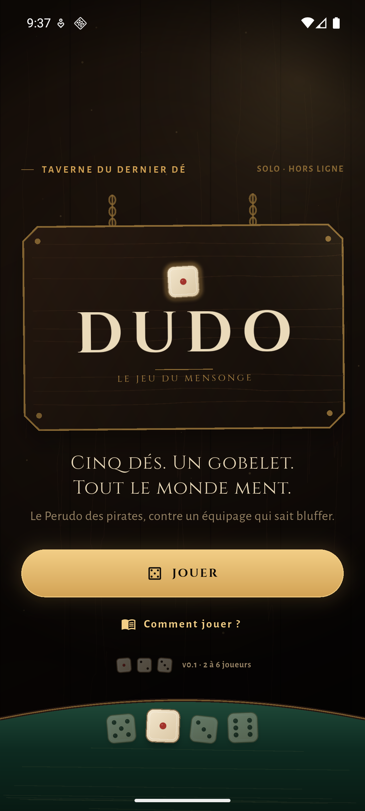
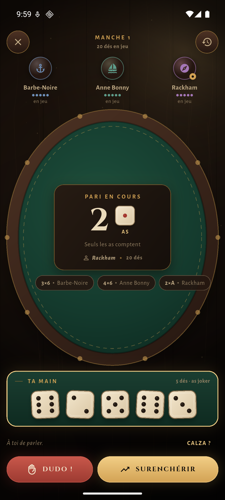
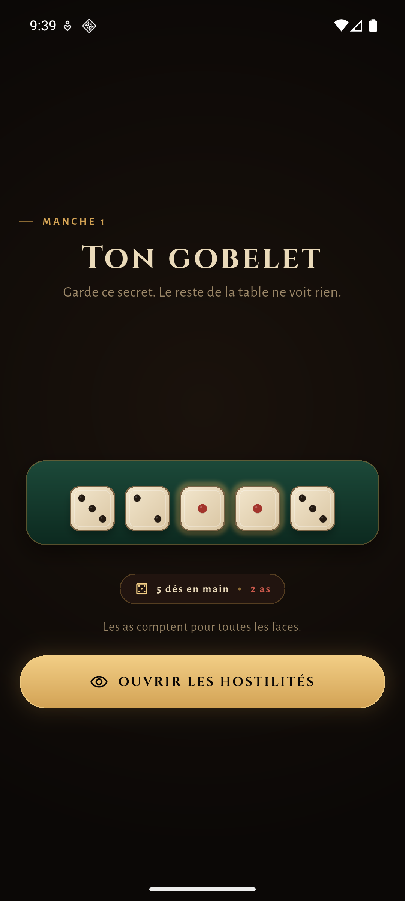
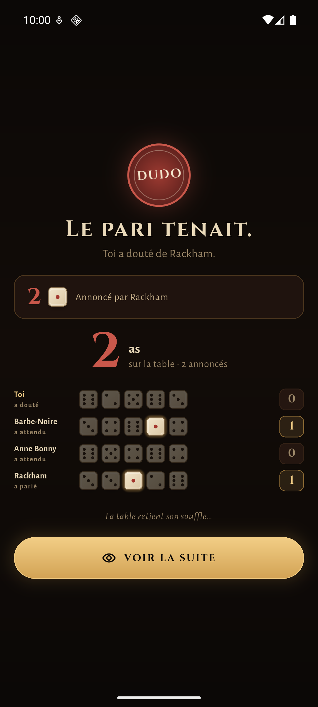

# Dudo — le Perudo de taverne

Dudo est un jeu de dés **solo contre des pirates** pour Android, écrit en Flutter. Cinq dés, un gobelet, une table de taverne, et un équipage qui ment très bien. Le code est gardé côté plateforme aussi neutre que possible : ce dépôt livre Android, et le même `lib/` pourra servir de base à un dépôt iOS séparé.

| Accueil | La table |
|---|---|
|  |  |
| **Ta main** | **La révélation** |
|  |  |

## Ce qui est jouable

- **1 joueur + 1 à 5 pirates IA**, 5 dés par joueur, dernière personne avec un dé gagne.
- **Règles Perudo complètes** : as joker, surenchères légales, dudo, calza optionnelle, perte de dé, élimination, manche suivante ouverte par le perdant.
- **Trois difficultés** : Mousse (prudent), Flibustier (équilibré), Capitaine (probabiliste et féroce).
- **IA sans triche** : chaque bot ne connaît que ses propres dés, le nombre de dés en jeu et le pari courant. Il estime les probabilités par loi binomiale, avec du bluff et du caractère.
- **Une vraie table** : gobelet privé, pari courant, historique des trois derniers coups, journal complet, confirmation avant un dudo ou une calza, résultats expliqués dé par dé.
- **Interface française, portrait, une main** : cibles de 48 dp, respect de la taille de police (testée à 1,3×), animations réduites si le système le demande, retour Android fonctionnel.
- **Aucun réseau, aucun compte, aucune pub, aucun analytics.** Le jeu tient entièrement dans l'APK.

## Lancer le projet

Prérequis utilisés pour cette version :

- Flutter **3.47.9** (Dart 3.13.7)
- Android SDK **36**, build-tools 36.0.0
- JDK **17**

```powershell
flutter pub get
flutter run
```

Builds :

```powershell
flutter build apk --debug

# Sur ce poste Windows au chemin accentué, le build release direct échoue
# (gen_snapshot ne lit pas app.dill sous un chemin utilisateur accentué). Le script mappe le
# dépôt sur un lecteur ASCII temporaire le temps du build :
powershell -ExecutionPolicy Bypass -File tool\build_release.ps1

# APK séparés par ABI (plus légers pour la distribution) :
powershell -ExecutionPolicy Bypass -File tool\build_release.ps1 --split-per-abi

# Si le cache a été créé sous un autre lecteur (le script utilise X:) :
powershell -ExecutionPolicy Bypass -File tool\build_release.ps1 -Clean
```

L'APK est écrit dans `build/app/outputs/flutter-apk/`. Le build universel
release fait environ 46 Mo ; les APK par ABI font 14–18 Mo. La configuration
`release` du template signe encore avec la clé debug : à remplacer par un
keystore avant une publication Play Store.

Tests et analyse :

```powershell
flutter test
dart analyze lib test
```

La suite couvre les règles, les probabilités et la légalité des décisions des bots, des parties complètes simulées (1 à 5 adversaires, toutes difficultés, calza), le parcours widget principal, et les overlays à 1,3× de taille de police.

### Note sur ce poste Windows

Le dépôt vit sous un chemin utilisateur contenant un caractère accentué, que Gradle refuse par défaut. `android/gradle.properties` contient donc :

```properties
android.overridePathCheck=true
```

La toolchain de développement a été installée hors du profil utilisateur pour éviter le même problème :

- Flutter : `C:\tools\flutter`
- Android SDK : `C:\Android\Sdk`
- JDK : `C:\Program Files\Java\jdk-17.0.1`
- Cache Pub : `C:\tools\pub-cache`

Ajoute `C:\tools\flutter\bin`, `C:\Android\Sdk\platform-tools` et `C:\Android\Sdk\emulator` au `PATH` pour retrouver `flutter` et `adb`.

### CI et releases

Le workflow [`.github/workflows/android.yml`](.github/workflows/android.yml) tourne sur GitHub Actions :

- **push sur `main` et pull requests** : `flutter pub get`, `dart analyze`, `flutter test`, puis build de l'APK release ;
- l'APK est publié comme artefact **`dudo-android-apk`** dans l'onglet Actions du run (conservation 14 jours) ;
- **tag `v*`** : le même build attache l'APK à la GitHub Release, avec les notes générées.

```powershell
git tag v0.1.0
git push origin v0.1.0
```

L'APK produit par la CI est signé avec la clé debug du template, comme le build local : parfait pour tester et partager, pas encore pour le Play Store.

**Cloudflare** : Workers Builds ne fournit ni Android SDK ni Gradle, donc il ne peut pas compiler l'APK. GitHub Actions s'en charge. Cloudflare pourra en revanche héberger le fichier (R2) ou servir la future API temps réel via un Worker.

## Architecture

```
lib/
  app.dart, main.dart
  core/
    theme/       couleurs, typographie, ThemeData
    widgets/     fond de taverne, dés, gobelet, table, boutons, ornements
  game/
    models/      Bid, Player, GameConfig, événements, résultat
    logic/       PerudoRules (pur), BotBrain + probabilités (pur)
    state/       GameController (ChangeNotifier, timers des bots)
  screens/
    home/        signe suspendu, CTA, bord de table
    setup/       équipage, difficulté, calza
    game/        table, sièges, feuille de pari, peek, révélation, fin, journal
    rules/       règles illustrées
test/
  perudo_rules_test.dart
  bot_brain_test.dart
  game_flow_test.dart
  widget_test.dart
  overlays_test.dart
```

Principes :

- `PerudoRules` et `BotBrain` ne dépendent pas de l'UI et sont testables en isolation.
- `GameController` est la seule source de vérité : phases `peek → bidding → reveal → roundOver → gameOver`, validation des coups, timers des bots, pause des bots quand un modal est ouvert.
- Les écrans écoutent le contrôleur et ne décident jamais de la légalité d'un coup.
- Aucun package runtime en dehors de Flutter et `flutter_localizations`. Les polices sont embarquées (OFL).

## Direction artistique

Taverne sombre et chaleureuse : bois, cuir, feutre vert, laiton, ivoire. Cinzel pour l'inscription, Alegreya Sans pour tout ce qui doit se lire pendant qu'un pirate vous ment. Le détail complet (palette, rôles, composants, motion, accessibilité) est dans [DESIGN.md](DESIGN.md) ; le cadre produit est dans [PRODUCT.md](PRODUCT.md), et les tokens sont aussi dans `.impeccable/design.json`.

## Suite possible

- **Dépôt iOS** : réutiliser `lib/`, ajouter la cible iOS, vérifier safe areas, back-swipe et Reduce Motion.
- **API Cloudflare Worker** : salons temps réel, état autoritatif, reconnexion ; le moteur de règles est déjà isolé et portable.
- **Pass-and-play** sur un seul téléphone.
- **Palifico**, statistiques persistantes, sons de dés, thèmes de table.

## Crédits

- Code et direction visuelle : projet Dudo.
- Polices : [Cinzel](https://fonts.google.com/specimen/Cinzel) et [Alegreya Sans](https://fonts.google.com/specimen/Alegreya+Sans), SIL Open Font License (fichiers de licence dans `assets/fonts/`).
- Dés, gobelet, table, icône et splash sont dessinés dans le projet (aucune image tierce).
- Perudo / Dudo est un jeu traditionnel ; ce projet n'est affilié à aucun éditeur.
